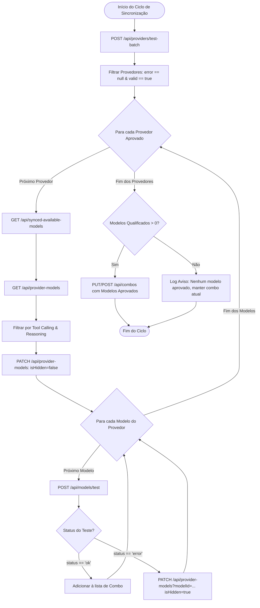

## Goal Capsule

- **Objective:** Substituir as heurísticas estáticas de strings por validação ativa contra a API real do OmniRoute, garantindo que o combo contenha exclusivamente modelos funcionais, com cotas ativas e compatíveis com Tool Calling e Reasoning.
- **Means:** Execução sequencial de diagnóstico de provedores (`test-batch`), sincronização de catálogo (`synced-available-models`), desocultação e teste individual de modelos (`models/test`), com auto-ocultação de modelos com falha e retry exponencial. (KTD1)
- **Authority Hierarchy:** Product Contract > Planning Contract > Implementation Units.
- **Stop Conditions:** Finalização da sincronização em modo one-shot ou encerramento gracioso via `SIGINT`/`SIGTERM` no modo contínuo. Em caso de ausência total de modelos válidos, o combo não é sobrescrito.
- **Execution Profile:** Execução sequencial monotarefa via HTTP para respeito a rate limits; zero dependências externas (`stdlib` Go puro).
- **Shipped By:** `ce-work` / desenvolvedor.

---

## Product Contract

### Summary
Esta funcionalidade transforma o Combobreak de um sincronizador baseado em leitura estática de `/v1/models` para um agente dinâmico de validação de catálogo. O sistema descobre provedores saudáveis, força a sincronização a montante no OmniRoute, desbloqueia modelos para chat, testa cada modelo com inferência real, quarentena automaticamente modelos com cota esgotada e monta o combo de roteamento com base nos modelos comprovadamente operacionais.

### Problem Frame
Atualmente, o Combobreak filtra modelos com base em campos de metadados como preço declarado (`pricing.input == 0`) e sufixos de identificador (`:free`). Na prática do OmniRoute, múltiplos modelos rotulados como gratuitos falham durante a inferência por falta de chaves ativas do provedor, incompatibilidade transitória de endpoint ou esgotamento de cota gratuita (HTTP 402). Isso gera falhas em cascata para os clientes que consomem o combo. A solução definitiva é testar os modelos ativamente na API do OmniRoute antes de incluí-los no combo.

### Key Decisions
- KD1. Live model testing replaces string-based cost heuristics. (session-settled: user-directed — chosen over static /v1/models parsing: eliminates false positives from exhausted free quotas) Governs R1, R5, R6.
- KD2. Sequential execution with exponential backoff for rate limit avoidance. (session-settled: user-directed — chosen over concurrent testing: prevents upstream providers from throttling batch tests) Governs R8, R9.
- KD3. Automatic quarantine of failing models via provider patch. (session-settled: user-directed — chosen over silent exclusion: hides broken models in OmniRoute to clean the UI and downstream routing) Governs R7.
- KD4. Retain Tool Calling and Reasoning capability checks alongside live test validation. (session-settled: user-directed — chosen over testing all models regardless of capabilities: preserves combobreak purpose as an agentic-ready free combo) Governs R3.
- KD5. Trigger upstream sync via `synced-available-models` before reading provider models. (session-settled: user-directed — chosen over skipping: guarantees OmniRoute refreshes its internal model registry from provider upstreams) Governs R2.

### Requirements

#### Provedores e Descoberta de Catálogo
- R1. O sistema deve consultar `POST /api/providers/test-batch` com `{"mode":"all","providerId":null}` e filtrar apenas provedores com `error == null` (e `valid == true`).
- R2. Para cada provedor aprovado, o sistema deve executar sequencialmente `GET /api/synced-available-models?provider=<provider>`, ignorando o corpo da resposta.
- R3. O sistema deve consultar `GET /api/provider-models?provider=<provider>` para extrair a lista de modelos candidatos e confrontá-los com as capacidades requeridas de Tool Calling e Reasoning.
- R4. O sistema deve emitir `PATCH /api/provider-models?provider=<provider>` com payload `{"isHidden": false, "modelIds": [...], "modality": "chat"}` para os modelos candidatos, garantindo que estejam visíveis antes do teste.

#### Teste Ativo e Quarentena
- R5. O sistema deve testar cada modelo elegível individualmente via `POST /api/models/test` com `{"providerId":"<provider>","modelId":"<modelId>"}`.
- R6. Modelos com resposta `status == "ok"` devem ser qualificados para inclusão no combo.
- R7. Modelos com resposta `status == "error"` devem ser excluídos do combo e ocultados imediatamente no provedor via `PATCH /api/provider-models?provider=<provider>&modelId=<modelId>` com `{"isHidden": true, "modality": "chat"}`.

#### Resiliência Operacional e Arquitetura
- R8. Todas as requisições HTTP de descoberta e teste devem ser estritamente sequenciais (concorrência = 1), prevenindo bloqueios por rate limit.
- R9. Falhas transitórias de rede ou respostas HTTP 429/5xx em chamadas de infraestrutura devem sofrer até 3 tentativas com backoff exponencial. Erros funcionais de teste de modelo (ex: HTTP 402 cota esgotada) são tratados como resultado definitivo do teste e não disparam retry de rede.
- R10. O fluxo deve preservar as flags CLI existentes (`-dry-run`, `-verbose`, `-interval`, `-timeout`, `-combo-name`, `-strategy`), permitindo auditoria prévia sem alteração no OmniRoute.
- R11. O projeto deve manter estritamente zero dependências externas no arquivo `go.mod`.

### Scope Boundaries
- **In Scope:** Endpoints de teste de provedor, sincronização, listagem, desocultação, teste de modelo, ocultação de modelo com falha, montagem do combo e retries com backoff.
- **Non-Goals (Considered and Not Built):**
  - Concorrência/Workers paralelos: Descartado deliberadamente por orientação do usuário para evitar rate limits agressivos das APIs dos provedores.
  - Testes de modalidades não-chat (áudio, vídeo, imagem): O Combobreak é focado em modelos de linguagem com suporte a ferramentas e raciocínio.
- **Deferred to Follow-Up Work:**
  - Persistência em cache local de latências de modelos aprovados para ordenar prioridade no combo.

### Success Criteria
- 100% dos modelos incluídos no combo foram testados e responderam `status: ok` no ciclo atual.
- Nenhum modelo com erro HTTP 402 ou falha de chave permanece ativo no combo.
- Modelos rejeitados são marcados com `isHidden: true` no OmniRoute via chamada confirmada de PATCH.
- O suíte completo de testes do repositório passa sem quebras com cobertura para os novos fluxos de mock HTTP.

---

## Planning Contract

### Key Technical Decisions
- KTD1. **OmniRoute Client Extension:** Adicionar ao `Client` métodos específicos para os novos endpoints: `TestBatchProviders`, `SyncAvailableModels`, `GetProviderModels`, `UnhideProviderModels`, `TestModel` e `HideProviderModel`. (session-settled: user-directed — chosen over generic doRequest exposure: guarantees strong typing and centralized error wrapping per R1, R2, R4, R5, R7)
- KTD2. **ComboStep Model Mapping Strategy:** No OmniRoute, o payload do combo aceita tanto o ID do modelo quanto o campo explícito `providerId`. Para evitar ambiguidades quando múltiplos provedores oferecem modelos de mesmo nome, cada step do combo conterá `Model: modelID` e `ProviderID: providerId`. (session-settled: user-directed — chosen over raw model ID alone: disambiguates identical model slugs across providers)
- KTD3. **Retry com Backoff Exponencial stdlib:** Implementar função utilitária `doWithRetry` no pacote `omniroute` usando apenas `time.Sleep` e verificação de contexto `ctx.Done()`. Apenas status transitórios (429, 500, 502, 503, 504) ou erros de timeout sofrem retry (1s, 2s, 4s). Erros de modelo (ex: status "error" no JSON de `/api/models/test`) são tratados como resposta de negócio válida. Governs R9.
- KTD4. **Separação de Responsabilidades (SyncOrchestrator):** Criar um componente de sincronização `LiveSyncCoordinator` em `omniroute/sync.go` que coordena o fluxo sequencial entre `Client` e `ModelFilter`, mantendo `main.go` limpo e focado no ciclo de vida da aplicação (CLI, ticker, sinais de SO). Governs R10.

### High-Level Technical Design



---

## Implementation Units

### U1. OmniRoute DTOs & Estruturas de Dados
- **Goal:** Definir todos os tipos e payloads necessários para os novos endpoints da API do OmniRoute.
- **Requirements:** R1, R3, R4, R5, R7.
- **Dependencies:** Nenhuma.
- **Files:** `omniroute/models.go`, `omniroute/models_test.go`
- **Approach:**
  1. Definir `ProviderTestBatchRequest` (`{"mode":"all","providerId":null}`) e `ProviderTestBatchResponse` com slice de `ProviderTestResult`.
  2. Definir `ProviderModelsResponse` contendo `Models`, `ModelCompatOverrides`, e `HiddenModelsByProvider`.
  3. Definir `PatchProviderModelsRequest` para desbloqueio em lote (`{"isHidden": false, "modelIds": [...], "modality": "chat"}`).
  4. Definir `ModelTestRequest` (`{"providerId": "...", "modelId": "..."}`) e `ModelTestResponse` (`{"status": "ok"|"error", "latencyMs": ..., "error": ..., "statusCode": ...}`).
  5. Definir `PatchSingleModelRequest` para ocultação individual (`{"isHidden": true, "modality": "chat"}`).
- **Patterns to follow:** Estruturas JSON existentes em `omniroute/models.go` com tags snake_case/camelCase fiéis à API.
- **Test scenarios:**
  - Parsing de resposta bem-sucedida de `test-batch` contendo provedores válidos e com falha.
  - Parsing de resposta de `provider-models` com compatOverrides.
  - Parsing de `models/test` para respostas de sucesso (`status: "ok"`) e respostas de cota esgotada (`status: "error"`, statusCode 402).
- **Verification:** Testes unitários de marshal/unmarshal em `models_test.go` passando sem erros.

### U2. Métodos HTTP com Retry Exponencial no Cliente OmniRoute
- **Goal:** Implementar as chamadas aos novos endpoints da API no `Client`, com tratamento de retries e backoff para falhas transitórias de rede.
- **Requirements:** R1, R2, R4, R5, R7, R8, R9.
- **Dependencies:** U1.
- **Files:** `omniroute/client.go`, `omniroute/client_test.go`
- **Approach:**
  1. Implementar função auxiliar `doRequestWithRetry(ctx, method, path, body, maxRetries)` que aplica exponential backoff (1s, 2s, 4s) para status 429 e 5xx ou erros de rede.
  2. Implementar `TestBatchProviders(ctx) ([]ProviderTestResult, error)`.
  3. Implementar `SyncAvailableModels(ctx, provider string) error` (ignora payload de retorno).
  4. Implementar `GetProviderModels(ctx, provider string) (*ProviderModelsResponse, error)`.
  5. Implementar `UnhideProviderModels(ctx, provider string, modelIDs []string) error`.
  6. Implementar `TestModel(ctx, providerId, modelId string) (*ModelTestResponse, error)`.
  7. Implementar `HideProviderModel(ctx, providerId, modelId string) error`.
- **Patterns to follow:** Padrão existente em `client.go` utilizando `c.HTTPClient.Do(req)` e headers `Authorization`.
- **Test scenarios:**
  - Servidor de mock retornando HTTP 500 duas vezes e sucesso na terceira tentativa (validando backoff).
  - Execução de `TestBatchProviders` filtrando requisição autenticada.
  - Execução de `UnhideProviderModels` enviando payload correto.
  - Chamada a `HideProviderModel` com URL encoding adequado de caracteres especiais no `modelId` (ex: `mistral-large-3:675b` vira `mistral-large-3%3A675b`).
- **Verification:** Todos os métodos testados com `httptest.Server` em `client_test.go`.

### U3. Orquestrador de Sincronização Dinâmica (Live Sync Coordinator)
- **Goal:** Implementar o fluxo sequencial completo que descobre provedores, filtra modelos por capacidade, testa cada um e atualiza o combo.
- **Requirements:** R1, R2, R3, R4, R5, R6, R7, R8.
- **Dependencies:** U1, U2.
- **Files:** `omniroute/sync.go`, `omniroute/filter.go`, `omniroute/sync_test.go`
- **Approach:**
  1. Criar `Coordinator` com referências a `*Client` e `*ModelFilter`.
  2. Implementar `Sync(ctx, comboName, strategy string, dryRun, verbose bool) (*SyncReport, error)`.
  3. No fluxo de `Sync`:
     a. Obter provedores válidos via `TestBatchProviders`.
     b. Para cada provedor, invocar `SyncAvailableModels`.
     c. Obter modelos do provedor via `GetProviderModels`.
     d. Para cruzar com os critérios de Tool Calling e Reasoning, consultar o catálogo de `/v1/models` (em cache durante a rodada) ou inspecionar overrides locais.
     e. Chamar `UnhideProviderModels` com os modelos candidatos.
     f. Iterar estritamente de forma sequencial testando cada modelo com `TestModel`.
     g. Se `status == "ok"`, incluir em `approvedSteps`.
     h. Se `status == "error"`, invocar `HideProviderModel(ctx, provider, modelId)`.
     i. Se `approvedSteps > 0`, efetuar `UpsertCombo` (respeitando `-dry-run`).
- **Patterns to follow:** Injeção de dependências via struct e logging consistente `[INFO]`, `[DEBUG]`, `[WARN]`, `[ERROR]`.
- **Test scenarios:**
  - Fluxo completo com 2 provedores: 1 falho no teste em lote (descartado), 1 válido com 2 modelos.
  - Modelo A passa no teste -> adicionado ao combo.
  - Modelo B falha no teste com HTTP 402 -> chamada de ocultação disparada e excluído do combo.
  - Cenário onde nenhum modelo passa no teste -> combo existente é preservado sem chamada de PUT/POST destrutiva.
  - Respeito ao flag `dryRun == true` sem chamadas de mutação (POST combo / PATCH hide).
- **Verification:** Suíte completo de testes em `sync_test.go` com mock de ciclo de vida completo.

### U4. Integração no CLI e Loop Principal (`main.go`)
- **Goal:** Conectar o novo fluxo de sincronização em `main.go`, preservando o suporte a flags CLI, watcher contínuo e encerramento gracioso.
- **Requirements:** R8, R10, R11.
- **Dependencies:** U3.
- **Files:** `main.go`, `config/config.go`
- **Approach:**
  1. Atualizar a função `runSync` em `main.go` para utilizar o `Coordinator`.
  2. Imprimir logs detalhados de progresso em tempo real (qual provedor está sendo verificado, qual modelo está sendo testado e sua latência).
  3. Garantir que o cancelamento de contexto (`Ctrl+C`) interrompa imediatamente a iteração sequencial de testes sem deixar processos pendentes.
- **Patterns to follow:** Padrão existente de tratamento de sinais em `main.go`.
- **Test scenarios:**
  - Execução de `main.go` com `-dry-run` e `-verbose`.
  - Cancelamento prematuro do contexto durante a sequência de testes de modelos interrompe o laço graciosamente.
- **Verification:** Teste de integração end-to-end em `main_test.go` atualizado e executando com sucesso.

---

## Verification Contract

### Comandos de Teste do Repositório
```bash
# Executar todos os testes unitários e de integração
go test -v ./...

# Análise estática
go vet ./...

# Compilação limpa do binário
go build -o combobreak .
```

### Critérios de Aceitação de Teste
- Mock completo simulando a resposta fornecida pelo usuário (`POST /api/providers/test-batch`, `GET /api/provider-models`, `PATCH /api/provider-models`, `POST /api/models/test`).
- Verificação explícita de que modelos com erro recebem o PATCH de ocultação com URL encoding correto de dois pontos (`:` -> `%3A`).
- Ausência de concorrência (`goroutines` paralelas) durante o loop de testes de modelos.
- Verificação de retry exponencial em falhas 5xx de infraestrutura.

---

## Definition of Done

- [ ] Todos os novos tipos DTO definidos com mapeamento JSON rigoroso em `omniroute/models.go`.
- [ ] Métodos do `Client` implementados para todos os endpoints informados.
- [ ] Orquestrador sequencial com suporte a retries implementado e coberto por testes unitários.
- [ ] `main.go` atualizado para orquestrar o novo fluxo mantendo compatibilidade com flags existentes.
- [ ] Limpeza completa de qualquer código legado ou de teste descartado.
- [ ] `go test -v ./...` executando com 100% de sucesso.
- [ ] `go vet ./...` sem apontamentos.
- [ ] `go.mod` permanece sem nenhuma dependência externa adicionada.
